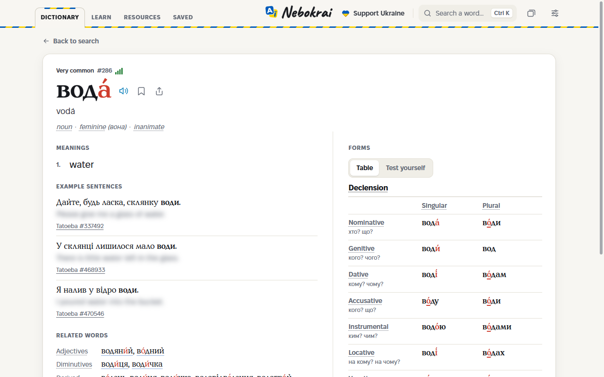
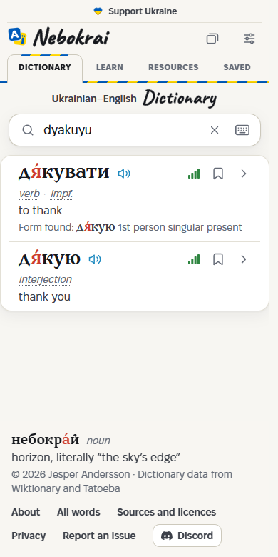

<div align="center">


# Nebokrai

**A free Ukrainian–English dictionary and learning site.**<br>
*Небокрай* means "horizon", literally "sky's edge".

[](https://github.com/Jesper-Andersson/nebokrai/actions/workflows/ci.yml)
[](LICENSE)
[](https://nebokrai.app)

[**Open the site**](https://nebokrai.app) · [How it is built](#how-it-is-built) · [Run it locally](#run-it-locally) · [API](docs/api.md) · [Sources](docs/sources-and-licences.md)

</div>

<table>
<tr>
<td width="70%">
<picture>
  <source media="(prefers-color-scheme: dark)" srcset="docs/images/word-desktop-dark.png">
  
</picture>
</td>
<td width="30%">
<picture>
  <source media="(prefers-color-scheme: dark)" srcset="docs/images/search-phone-dark.png">
  
</picture>
</td>
</tr>
</table>

## What it does

- **Search the way you can type.** Ukrainian, Latin letters or English: `dyakuyu` finds *дякую*, `voda`
  finds *вода*, and small misspellings still land.
- **Every word fully shown.** Stress marked, audio, every inflected form in a table, example sentences, related
  words and how common the word is.
- **Learn, not only look up.** An alphabet drill, the 1,000 most common words, grammar in plain English,
  case practice in real sentences, and flashcards that bring a word back just before you would forget it.
- **Keep your words.** Save words into lists, in the browser or with a Google or GitHub account; import an Anki
  deck with its progress, or a word list from a text or CSV file.
- **Made for daily use.** English or Ukrainian interface, light, dark and sepia themes, installable on phone
  and desktop, an Android app. No ads and no tracking.

## How it is built

| Part | What |
|---|---|
| Site | [SvelteKit](https://svelte.dev) 3 and Svelte 5, TypeScript, running on Cloudflare Workers |
| Data | SQLite: Cloudflare D1 in production, local `.db` files in development |
| Dictionary | Built by standard-library Python from Wiktionary, Tatoeba, FrequencyWords and VESUM ([`data/README.md`](data/README.md)) |
| Search | A reference search in Python (`data/search.py`); the site's TypeScript port must return the same rows in the same order, and `npm test` checks it |

## Run it locally

Needs Node.js 22.18 or later, and the dictionary databases built as [`data/README.md`](data/README.md) describes.

```sh
npm install
npm run dev     # http://localhost:5173
npm run check   # type and Svelte checks
npm test        # tests; the search ones need the databases
```

Optional sign-in, the in-page text editor and the installable app are in
[`docs/development.md`](docs/development.md).

## Repository map

| Path | |
|---|---|
| [`src/routes/`](src/routes) | The site's pages and API endpoints |
| [`src/lib/`](src/lib) | Components, settings, interface text; `search/` is the search port, `server/` picks the database |
| [`data/`](data) | Scripts that build the dictionary from open data |
| [`tests/`](tests) | Search parity, accounts, the installable app and more (`npm test`) |
| [`docs/`](docs) | [API](docs/api.md) · [sources and licences](docs/sources-and-licences.md) · [development](docs/development.md) · [deploying](docs/deploying.md) · [Android app](docs/android.md) |

## Data and licences

The dictionary data is not in this repository; the scripts in `data/` build it from these sources.

| Source | Gives | Licence |
|---|---|---|
| [Wiktionary](https://en.wiktionary.org) | words, meanings, forms, stress | CC BY-SA 4.0 |
| [Tatoeba](https://tatoeba.org) | example sentences | CC BY 2.0 FR |
| [FrequencyWords](https://github.com/hermitdave/FrequencyWords) | how common a word is | CC BY-SA 4.0 |
| [VESUM](https://github.com/brown-uk/dict_uk) | inflected forms | CC BY-NC-SA 4.0 |

VESUM's licence is non-commercial, so it is kept in a database of its own and a site that serves it must be
non-commercial too. [`docs/sources-and-licences.md`](docs/sources-and-licences.md) credits each source in full.

## Contributing

Issues and pull requests are welcome. A mistake in a word is quickest to report from the site itself
([Report an issue](https://nebokrai.app/report)). For code: run `npm run check` and `npm test` with both
databases before opening a pull request, and write comments and docs in British spelling.

## Licence

The code is free software under the GNU Affero General Public License, version 3 or later ([`LICENSE`](LICENSE)).
Copyright © 2026 Jesper Andersson. If you run a changed copy as a site, the licence asks you to offer your
visitors its source.

<details>
<summary>Files that are not the project's own and keep their own terms</summary>

| Files | Terms |
|---|---|
| `src/lib/assets/fixel/`, `nyght-serif-main/`, `serif/` | Fonts under the SIL Open Font License 1.1; each folder holds its licence. |
| `src/lib/assets/zakon/` | Zakon, the national typeface of the Ministry of Culture of Ukraine, given for free use by anyone (mincult.gov.ua/zakon); the TTFs as published, the WOFF2 files converted from them unchanged. |
| `src/lib/logo-paths.ts`, `src/lib/title-paths.ts` | Outlines of Caveat Bold, OFL 1.1 (`src/lib/assets/licences/Caveat-OFL.txt`). |
| `src/lib/assets/logo-icon.svg`, `static/favicon.ico`, `static/icons/` | Hold outlines of Montserrat ExtraBold, OFL 1.1 (`src/lib/assets/licences/Montserrat-OFL.txt`). |
| The bars' timings in `src/lib/RadioPlayer.svelte` | From SVG Loaders, MIT (`src/lib/assets/licences/SVG-Loaders-MIT.txt`). |
| `src/lib/assets/backgrounds/` | Photos under the Unsplash and Pexels licences. |
| `static/funds/` | Each logo belongs to its fund. No licence is given for them. |
| `docs/images/` | Screenshots of the site, showing dictionary data: Wiktionary, CC BY-SA 4.0; Tatoeba sentences, CC BY 2.0 FR. |
| `tests/search-cases.json`, and the dictionary examples in `tests/` and `docs/` | Taken from the dictionary data: Wiktionary, CC BY-SA 4.0; one Tatoeba sentence, CC BY 2.0 FR. Two rows of `search-cases.json` (`соловейко`, `книжечка`) come from VESUM, CC BY-NC-SA 4.0. |

</details>
